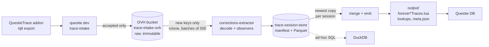

# Data flow

How a recorded play session becomes Questie DB corrections.



| Stage | Where | Notes |
|---|---|---|
| Record | `Modules/` (addon) | Events and API results per session, exported as a string |
| Intake | `questie.dev/trace` | Stores accepted submissions in the bucket; deletes rejected ones. Exports are cumulative, so one session shows up in many submissions |
| Raw | `ovhcloud-de:trace-intake-ovh/submissions/<yyyy-mm>/<stamp>_<id>.json` | Source of truth. Downloads are free |
| Observe | `tools/corrections-extractor/src/extract/observers/` | One file per field. Runs per session, emits observations with provenance |
| Store | `../trace-session-store/` | Observations of every processed submission. A run only observes new submissions |
| Merge + emit | `tools/corrections-extractor/src/extract/` | One fact per entity and field, written as Lua modules |
| Inspect | `tools/trace-analyzer/` | Web UI for single sessions and the extract output |

## Running

```sh
cd tools/corrections-extractor
TRACE_REMOTE=ovhcloud-de:trace-intake-ovh npm run extract   # from the bucket
npm run extract                                       # from a local ../trace-data checkout
```

Changing any observer code empties the store, and the next run observes everything again. Develop observers on a sample first (see [ADR 0004](adr/0004-develop-observers-on-a-sample.md)).

## Querying observations

```sh
duckdb -c "SELECT field, count(*) FROM '../trace-session-store/batches/*.observations.parquet' GROUP BY field"
```

Columns: `submission, batch, idx` (session), `kind` (0 scalar, 1 custom merge, 2 lookup), `field, entity, value` (JSON), `confidence, session_name, t, extra`. Session rows (`*.sessions.parquet`) hold `session_key, contributor, session_time`. Rows of submissions no longer in `manifest.json` are stale. Filter them out, or use the extractor's replay.

## Decisions

See [adr/](adr/).
