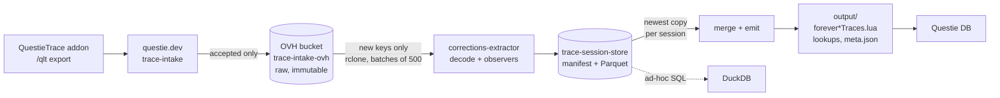

# Data flow

How a recorded play session becomes Questie DB corrections.



| Stage | Where | Notes |
|---|---|---|
| Record | `Modules/` (addon) | Events and API results per session, exported as a string |
| Intake | `questie.dev/trace` | Stores accepted submissions in the bucket; deletes rejected ones. Exports are cumulative, so one session shows up in many submissions |
| Raw | `ovhcloud-de:trace-intake-ovh/submissions/<yyyy-mm>/<stamp>_<id>.json` | Source of truth. Downloads are free |
| Observe | `tools/corrections-extractor/src/extract/observers/` | One file per field. Runs per session, emits observations with provenance |
| Store | `../trace-session-store/` | Observations of every processed submission. A run only observes new submissions |
| Merge + emit | `tools/corrections-extractor/src/extract/` | One fact per entity and field, written as Lua modules |
| Inspect | `tools/trace-analyzer/` | Web UI for single sessions and the extract output |

## Running

```sh
cd tools/corrections-extractor
npm run extract                                      # from the bucket (rclone remote ovhcloud-de)
TRACE_DATA_DIR=../../../trace-data npm run extract   # from a local checkout
```

Changing any observer code empties the store, and the next run observes everything again. Develop observers on a sample first (see [ADR 0004](adr/0004-develop-observers-on-a-sample.md)).

## Adding an observer

1. Write a test first, next to the observer: `src/extract/observers/<entity>/<field>.test.ts`.
2. Add the observer, one file per field. It reads one session and returns `Observation[]`, and never merges. Helpers for the player's state at a time live in `src/extract/probes.ts` (zone, position, faction, race, completed quests via `completedQuestsAt`, …). Values are stored as JSON, so they must survive `JSON.parse(JSON.stringify(v))`: no `undefined`, `NaN`, `Map` or `Set`.
3. Register it in `src/extract/observe.ts`:
   - `SCALAR_OBSERVERS` when one value per entity wins by count. These are summarized in DuckDB (`ObservedStore.scalarGroups`), so a change to `addToScalarSummary` must be mirrored there.
   - `OBSERVERS` with a merge function otherwise. Add the field to `OBSERVER_ENTITIES` so Classic IDs are dropped before they are stored.
   - Translations go in `observe-lookups.ts`, and are merged in `lookups.ts` (`finalizeLookups`).
4. Merge and emit in `src/extract/index.ts` (`finalize`) and `src/extract/emit/<entity>.ts`. Changes here don't rebuild the store.
5. Check on the sample: `EXTRACT_SAMPLE=5 npm run extract`, output in `output/sample-5/`.
6. Run on all data once it's done. The changed observer code rebuilds the store automatically.

Each person running full runs on one machine should use their own `TRACE_STORE_DIR`.

## Querying observations

Each run writes `sessions.parquet` and `views.sql` into the store. They hold only the sessions in use: the newest copy of each, from submissions still in the bucket.

```sh
cd ../trace-session-store   # from the QuestieTrace checkout; the store sits next to it
duckdb -init views.sql
```

```sql
-- Which builds and client locales the data comes from
SELECT build, client_locale, count(DISTINCT session_key) FROM observations GROUP BY ALL ORDER BY 3 DESC;
-- Spawn points of one NPC, with the unit token they were seen through
SELECT value->>'zoneID', value->>'x', value->>'y', extra->>'$.o.token' FROM observations WHERE field = 'npcSpawns' AND entity = 250873;
```

| View | Columns |
|---|---|
| `sessions` | `session_key, contributor, session_time, interface_version, build, locale, rank` (0 = newest submission), `submission, batch, idx` |
| `observations` | `session_key, contributor, session_time, interface_version, build, client_locale` (the session's), `kind` (`scalar`, `custom` or `lookup`), `field, entity, locale` (the translation's locale, lookups only), `value` (JSON), `confidence, t` (seconds into the session), `extra` (JSON, e.g. a spawn's `token`), `submission, idx` |

enUS lookup observations are not stored: lookups are translations, and enUS names are in the `scalar` rows. Sessions from other flavors than Forever have a session row but no observations. Session names are not stored, as players can name sessions freely.

## Decisions

See [adr/](adr/).
